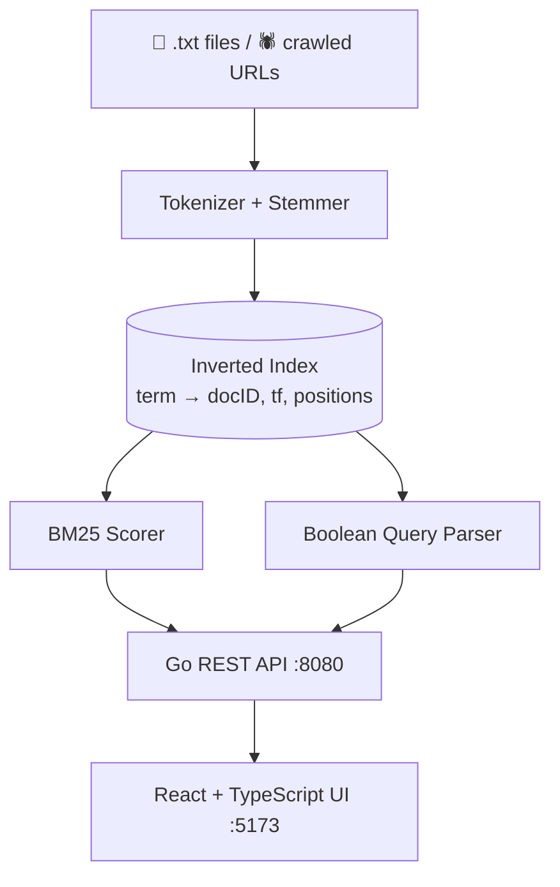

<div align="center">

```
██╗███╗   ██╗██████╗ ███████╗██╗  ██╗███████╗██╗  ██╗   ██╗
██║████╗  ██║██╔══██╗██╔════╝╚██╗██╔╝██╔════╝██║  ╚██╗ ██╔╝
██║██╔██╗ ██║██║  ██║█████╗   ╚███╔╝ █████╗  ██║   ╚████╔╝ 
██║██║╚██╗██║██║  ██║██╔══╝   ██╔██╗ ██╔══╝  ██║    ╚██╔╝  
██║██║ ╚████║██████╔╝███████╗██╔╝ ██╗██║     ███████╗██║   
╚═╝╚═╝  ╚═══╝╚═════╝ ╚══════╝╚═╝  ╚═╝╚═╝     ╚══════╝╚═╝   
```

### A full-text search engine built from scratch in Go

Inverted index · BM25 ranking · Boolean queries · Web crawler · React UI

<br />

[](https://go.dev)
[](https://react.dev)
[](https://typescriptlang.org)
[](https://tailwindcss.com)
[](./LICENSE)
[](./CONTRIBUTING.md)

<br />

[Demo](#demo) •
[Features](#features) •
[Quick Start](#quick-start) •
[Query Syntax](#query-syntax) •
[Architecture](#architecture) •
[API](#api-reference) •
[Roadmap](#roadmap)

</div>

---

## Overview

IndexFly is a search engine with no Elasticsearch, no Solr, and no search library underneath. The inverted index, tokenizer, BM25 scorer, Boolean query parser, and crawler are all written by hand, behind a Go REST API and a React + TypeScript frontend.

> *Understanding search means building one.*

**Why this project exists:** most developers use search as a black box. IndexFly opens the box. Every layer, from raw text to ranked results, is readable code you can step through.

## Demo

<!-- Replace with a real screenshot or GIF. This is the single biggest upgrade to this README. -->
<div align="center">
  
</div>

## Features

| | Feature | Details |
|---|---|---|
| 🔍 | **BM25 ranking** | Relevance scoring by term frequency, inverse document frequency, and length normalization. The same family of ranking used by Lucene and Elasticsearch |
| 🧮 | **Boolean queries** | `AND`, `OR`, and `AND NOT`, parsed at the token level |
| 📂 | **Inverted index** | In-memory postings lists storing document IDs, term frequencies, and positions |
| 🕷️ | **Web crawler** | Ingest external URLs straight into the index |
| ⚡ | **Live reindex** | Add `.txt` files and rebuild the index without restarting the server |
| 📊 | **Stats endpoint** | Document count, unique terms, and average document length |

## Quick Start

### Prerequisites

| Tool | Version | Install |
|---|---|---|
| Go | 1.21+ | [go.dev/dl](https://go.dev/dl) |
| Node.js | 16+ | [nodejs.org](https://nodejs.org) |

### 1. Start the backend

```bash
git clone https://github.com/kelvinagyareyeboah/IndexFly.git
cd IndexFly/backend
go run .
```

The API is now live at **http://localhost:8080**.

### 2. Start the frontend

```bash
cd ../frontend
npm install
npm run dev
```

Open **http://localhost:5173** and start searching.

<details>
<summary><b>Build a production binary</b></summary>

```bash
cd backend
go build -o indexfly .
./indexfly
```

</details>

## Query Syntax

| Query | Mode | Behaviour |
|---|---|---|
| `python data` | BM25 | Ranked by relevance across the index |
| `machine AND learning` | Boolean AND | Documents containing **both** terms |
| `database OR python` | Boolean OR | Documents containing **either** term |
| `database AND NOT SQL` | Boolean AND NOT | Contains `database`, excludes `SQL` |

## Architecture



### How BM25 scores a document

For a query *Q* and document *D*:

```text
score(D, Q) = Σ  IDF(qᵢ) · ( f(qᵢ, D) · (k₁ + 1) ) / ( f(qᵢ, D) + k₁ · (1 − b + b · |D| / avgdl) )
```

| Symbol | Meaning |
|---|---|
| `f(qᵢ, D)` | How often term `qᵢ` appears in document `D` |
| `IDF(qᵢ)` | How rare the term is across the whole index |
| `\|D\|` / `avgdl` | Document length and average document length |
| `k₁`, `b` | Tuning parameters for term saturation and length normalization |

Rare terms count for more, repeated terms have diminishing returns, and long documents are not unfairly favoured.

<details>
<summary><b>Project structure</b></summary>

```text
IndexFly/
├── backend/                 # Go API server
│   ├── main.go              # Entry point
│   ├── index/
│   │   ├── builder.go       # Index construction
│   │   ├── bm25.go          # BM25 scoring
│   │   └── boolean.go       # Boolean query parser
│   ├── crawler/             # Web crawler
│   ├── api/                 # REST route handlers
│   └── sample_docs/         # Drop .txt files here to index
└── frontend/                # React + TypeScript (Vite)
    ├── src/
    │   ├── components/      # SearchBar, Results, Stats
    │   └── utils/           # API service layer
    └── public/
```

</details>

## API Reference

**Base URL:** `http://localhost:8080`

| Method | Endpoint | Description |
|---|---|---|
| `GET` | `/api/search?q=<query>` | BM25 or Boolean search |
| `GET` | `/api/stats` | Index statistics |
| `GET` | `/api/reindex` | Rebuild the index from `sample_docs/` |

<details>
<summary><b>Example requests</b></summary>

```bash
# BM25 ranked
curl "http://localhost:8080/api/search?q=python+data"

# Boolean
curl "http://localhost:8080/api/search?q=machine+AND+learning"
curl "http://localhost:8080/api/search?q=database+OR+python"
curl "http://localhost:8080/api/search?q=database+AND+NOT+SQL"

# Stats and reindex
curl "http://localhost:8080/api/stats"
curl "http://localhost:8080/api/reindex"
```

</details>

<details>
<summary><b>Example responses</b></summary>

**`GET /api/search?q=python+data`**

```json
{
  "query": "python data",
  "mode": "bm25",
  "results": [
    {
      "doc_id": "doc_042",
      "title": "Introduction to Python Data Science",
      "score": 4.812,
      "snippet": "...Python is widely used in data analysis and machine learning..."
    }
  ],
  "total": 1,
  "elapsed_ms": 2
}
```

**`GET /api/stats`**

```json
{
  "total_documents": 128,
  "total_terms": 14302,
  "avg_document_length": 312.4
}
```

</details>

## Adding Your Own Documents

```bash
# 1. Drop any .txt file into the documents folder
cp my_document.txt backend/sample_docs/

# 2. Rebuild the index
curl http://localhost:8080/api/reindex
```

You can also click **Reindex** in the UI. New documents are searchable as soon as it finishes.

## Roadmap

**Shipped**

- [x] Inverted index from scratch
- [x] BM25 relevance ranking
- [x] Boolean query parser (`AND` / `OR` / `AND NOT`)
- [x] Live reindex endpoint
- [x] Index stats API
- [x] React + TypeScript search UI
- [x] Web crawler ingestion

**Next up**

- [ ] Phrase and proximity queries (`"exact phrase"`)
- [ ] Field-scoped search (`title:`, `body:`, `url:`)
- [ ] Persistent index storage (disk serialization)
- [ ] Fuzzy matching and typo tolerance
- [ ] Pagination and result cursors
- [ ] Query highlighting in snippets
- [ ] Docker and docker-compose setup
- [ ] Benchmark suite (indexing speed, query latency)

## Contributing

Contributions are welcome. For larger changes, please open an issue first so we can talk through the approach.

```bash
git checkout -b feature/your-feature
git commit -m "Add your feature"
git push origin feature/your-feature
```

Then open a Pull Request.

## License

Released under the [MIT License](LICENSE). © 2025 [Agyare Kelvin Yeboah](https://kelvinagyareyeboah.me).

---

<div align="center">

### Built by Kelvin Agyare Yeboah

Co-founder @ [Zoharix](https://zoharix.tech)

[](https://github.com/kelvinagyareyeboah)
[](https://x.com/_yo_kelvin)
[](https://www.linkedin.com/in/agyarekelvinyeboah)
[](https://kelvinagyareyeboah.me)
[](https://zoharix.tech)

<br />

⭐ **If IndexFly taught you something, give it a star.**

</div>
